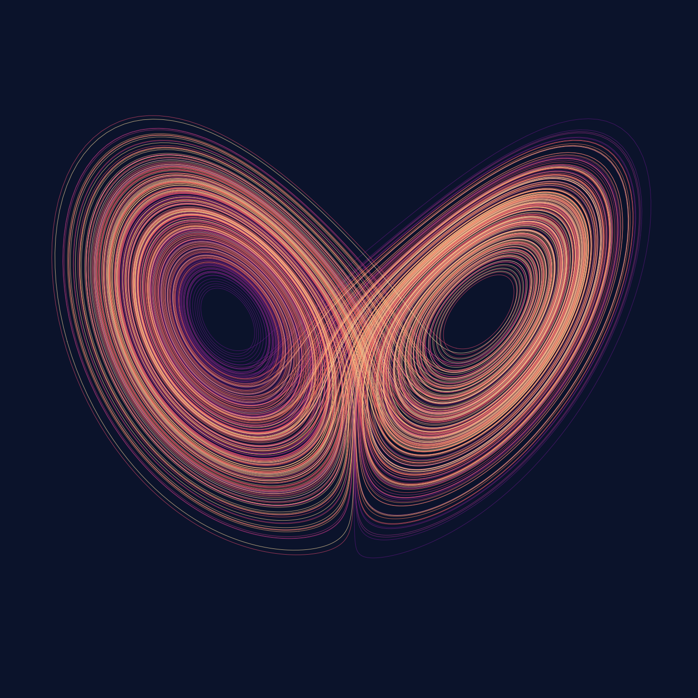

# Дивний атрактор Лоренца та детермінований хаос

Семестровий проєкт з дисципліни «Динамічні системи».
Ключові слова: хаотичні системи, чутлива залежність від початкових умов, моделювання погоди і хаос.

**Презентація:** [`presentation/main.pdf`](presentation/main.pdf) — науково-популярна доповідь на 15 хв (15 слайдів, Beamer + XeLaTeX, власна тема «Нічне небо»).

**Розгорнуте дослідження:** [`report/study.pdf`](report/study.pdf) — текст за етапами математичного моделювання: коректність за Адамаром, одновимірна редукція біля r = 1, верифікація і валідація.



## Що досліджено

| Тема | Власний результат | Література |
|---|---|---|
| Показники Ляпунова (алгоритм Бенеттіна, T = 10⁴) | λ = (0.9058, −0.0003, −14.572) | (0.9056, 0, −14.572) |
| Сума показників = div f | −13.6667 | −(σ+1+β) = −13.6667 |
| Гомоклінічний вибух (бісекція по W^u(O)) | r_hom = 13.9266 | 13.926 |
| Народження дивного атрактора | r_A = 24.058 | 24.06 |
| Субкритичний Хопф (Раус–Гурвіц, SymPy) | r_H = 470/19 ≈ 24.737 | 24.74 |
| Розмірність Каплана–Йорке | D_KY = 2.062 | 2.06 |
| Кореляційна розмірність (Грассбергер–Прокачча) | D₂ = 2.07 | 2.05 |
| Горизонт передбачуваності T_p ∝ ln(1/δ₀) | нахил 1.096 ≈ 1/λ₁ | 1/λ₁ = 1.104 |
| Лоренц-96 (N = 40, F = 8) | λ₁ = 1.68, 13 додатних, D_KY ≈ 27 | те саме |
| Асиміляція даних EnKF | RMSE 0.50 при шумі вимірювань 2 | — |

### Бонус: застосування поза погодою (`experiments/applications.py`)

| Тема | Власний результат |
|---|---|
| Секретний зв'язок (Куомо–Оппенгейм) | Морзе «ХАОС» (4% сигналу) відновлено; але ключ r вгадується з точністю 0.1 → схема не криптостійка |
| Водяне колесо Малкуса (24 відра) | моди маси = Лоренц з β = 1; λ₁ = 0.492, 132 реверси за 270 од. часу |
| Reservoir computing (ESN, 800 вузлів) | прогноз без рівнянь: 9.6 ляпуновських часів (4.1–15.6), «клімат» (відображення Лоренца) відтворено |
| SINDy (розріджена регресія) | σ, r, β відновлено до 10⁻⁶; з шумом 0.5 — до 0.5%; з даних колеса знайдено β = 1.00 |

## Структура

```
lorenzlab/              власна бібліотека (Python + Numba)
  core.py               система Лоренца, якобіан, RK4 / Ейлер / float32, варіаційні рівняння, рівноваги
  lyapunov.py           алгоритм Бенеттіна (Грам–Шмідт), λ_i(r), FTLE, розмірність Каплана–Йорке
  analysis.py           відображення Лоренца, перетин Пуанкаре, біфуркаційна діаграма,
                        кореляційна розмірність, бісекції для r_hom та r_A, перехідний хаос
  weather.py            горизонт передбачуваності, ансамблі, Лоренц-96, EnKF
  applications.py       хаотичний зв'язок, водяне колесо Малкуса, мережа луни (ESN), SINDy
  style.py              стиль графіків
experiments/
  analytic.py           символьна перевірка формул (SymPy) -> results/analytic.txt
  run_all.py            19 чисельних експериментів -> results/results.json, results/numbers.tex
                        (+ детальні дослідницькі графіки у figures/, не входять у репозиторій)
  popfigs.py            графіки для презентації -> figures/pop_*.png
  applications.py       бонус-застосування -> results/numbers_apps.tex, figures/pop_{secret,wheel,reservoir,sindy}.png
tests/                  11 тестів коректності (pytest)
figures/                рисунки, що використовуються в презентації
results/                числові результати; numbers.tex підставляється в презентацію
presentation/
  main.tex, main.pdf    презентація
  beamerthemeNight.sty  власна тема оформлення
```

## Відтворення

```bash
python3 -m venv .venv
.venv/bin/pip install -r requirements.txt
.venv/bin/python -m pytest -q tests          # перевірка коректності
.venv/bin/python experiments/analytic.py     # аналітика
.venv/bin/python experiments/run_all.py      # усі експерименти (~10 хв на 8 ядрах)
.venv/bin/python experiments/popfigs.py      # графіки для презентації
.venv/bin/python experiments/applications.py # бонус-застосування (~25 с)
.venv/bin/python experiments/lecture_study.py # графіки й числа для report/
(cd report && latexmk -xelatex study.tex)
cd presentation && latexmk -xelatex main.tex
```

Для збірки потрібні XeLaTeX, шрифти Fira Sans / Fira Math (пакети TeX Live `fira`, `firamath-otf`)
та `babel-ukrainian`.

## План доповіді (15 хв)

| Слайди | Зміст |
|---|---|
| 1–2 | Історія 1961 р.: округлення, що змінило науку |
| 3–4 | Модель конвекції; детермінізм ≠ передбачуваність |
| 5–7 | Стискання об'єму, дивний атрактор, шлях до хаосу (біфуркації) |
| 8–10 | Ефект метелика, показники Ляпунова, межа прогнозу |
| 11–12 | Ансамблеві прогнози й асиміляція даних |
| 13–15 | Власні результати, висновки |
| 16–20 | *Бонус (запасні слайди):* Лоренц поза погодою — лазер, динамо, водяне колесо, секретний зв'язок, нейромережа-прогнозист, SINDy |
